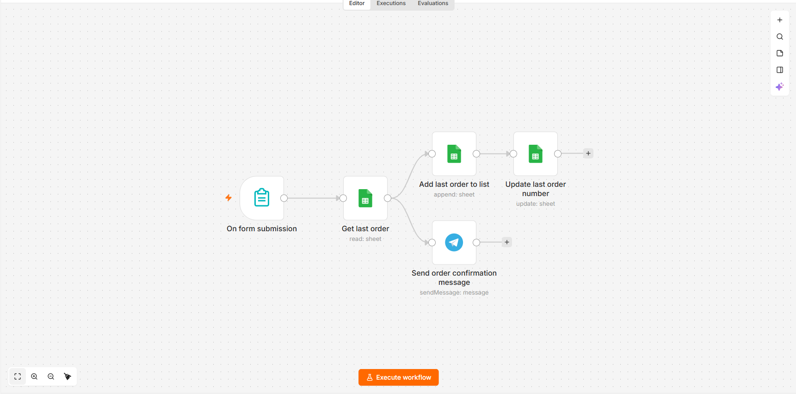
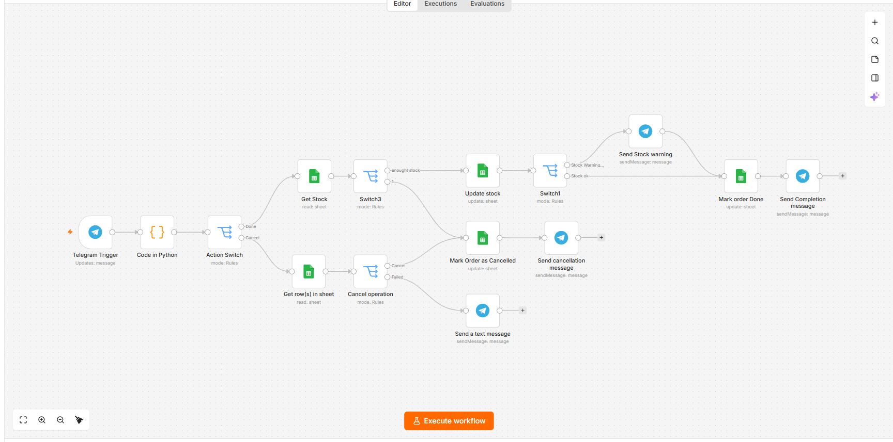
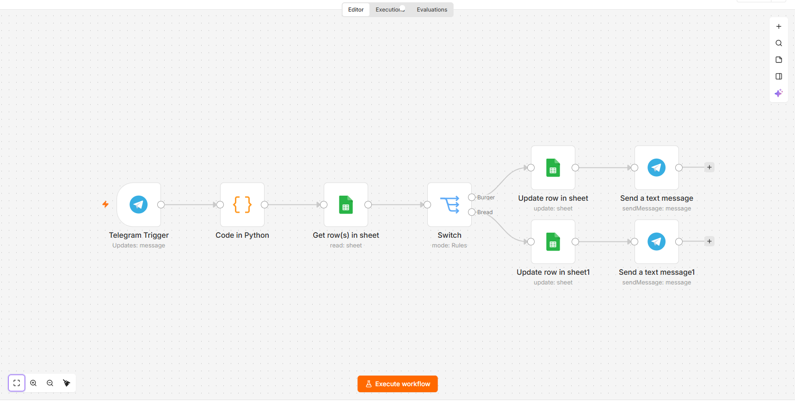

# n8n Restaurant Order Automation

A complete order management system built with [n8n](https://n8n.io/) that handles customer orders, order fulfillment, and stock tracking via Google Sheets and Telegram.

## Workflows

| Workflow | Purpose |
|----------|---------|
| **Create Orders** | Customer submits an order via a web form. The order is appended to the Orders sheet, assigned an incrementing order number, and a confirmation is sent to Telegram. |
| **Orders confirmation** | Staff send `Done <order#>`, `Cancel <order#>`, or `Done <order#>` commands to a Telegram bot. The workflow updates the order status, decrements stock, and notifies staff. |
| **Update Stock** | Staff send `Burger <qty>` or `Bread <qty>` to a Telegram bot to add stock back. The sheet is updated and a confirmation is sent. |

### Flow Overview

```
[Customer] --> [Web Form] --> [Create Orders] --> [Google Sheets: Orders]
                                              --> [Google Sheets: Last Order]
                                              --> [Telegram: Confirmation]

[Staff] --> [Telegram Bot] --> [Orders confirmation] --> [Google Sheets: Status]
                                                     --> [Google Sheets: Stock]
                                                     --> [Telegram: Reply]

[Staff] --> [Telegram Bot] --> [Update Stock] --> [Google Sheets: Stock]
                                              --> [Telegram: Reply]
```

## Screenshots

### Create Orders


### Orders confirmation


### Update Stock


## Prerequisites

- **n8n** instance (self-hosted or cloud) — version 1.x or later
- **Google account** with Google Sheets access
- **Telegram account** and a bot created via [@BotFather](https://t.me/BotFather)
- Three Google Sheets (see [Setup](#setup))

## Required Google Sheets

You must create **three** Google Sheets. Column headers must match exactly (case-sensitive).

### 1. Last Order sheet
Stores the current order counter.

| Name | Number |
|------|--------|
| Last Order | 0 |

### 2. Orders sheet
Stores every submitted order.

| Name | Phone | Item | Price | Date | Status | Order Number |
|------|-------|------|-------|------|--------|--------------|

### 3. Stock sheet
Tracks available ingredients.

| burger | bread |
|--------|-------|
| 50     | 50    |

> Row 2 must be the first data row in the Stock sheet (the update nodes currently target `row_number: 2`).

## Setup

### Step 1 — Import the workflows

1. Open your n8n instance.
2. In the left sidebar, click **Workflows** → **Add workflow** → **Import from File**.
3. Import each JSON file:
   - `Create Orders.json`
   - `Orders confirmation.json`
   - `Update Stock.json`

Alternatively, you can copy the JSON content and paste it directly into the n8n canvas.

### Step 2 — Configure Google Sheets credentials

1. Go to [Google Cloud Console](https://console.cloud.google.com/).
2. Create a new project (or select an existing one).
3. Enable the **Google Sheets API** and **Google Drive API**.
4. Go to **APIs & Services** → **Credentials** → **Create Credentials** → **OAuth client ID**.
5. Choose **Web application**, add `https://your-n8n-instance/rest/oauth2-credential/callback` as an authorized redirect URI.
6. Copy the **Client ID** and **Client Secret**.
7. In n8n, go to **Credentials** → **New** → **Google Sheets OAuth2 API** and paste them.
8. Click **Sign in with Google** to authorize.

### Step 3 — Configure Telegram credentials

1. Open Telegram and message [@BotFather](https://t.me/BotFather).
2. Send `/newbot` and follow the prompts. Save the **bot token**.
3. In n8n, go to **Credentials** → **New** → **Telegram API** and paste the token.
4. In each Telegram node, select this credential.
5. Replace `YOUR_TELEGRAM_CHAT_ID` in every Telegram node with your own chat ID (get it from [@userinfobot](https://t.me/userinfobot)).

### Step 4 — Replace placeholders

In every imported workflow, replace these placeholders:

| Placeholder | Replace with |
|-------------|--------------|
| `YOUR_LAST_ORDER_SHEET_ID` | The ID of your Last Order sheet |
| `YOUR_ORDERS_SHEET_ID` | The ID of your Orders sheet |
| `YOUR_STOCK_SHEET_ID` | The ID of your Stock sheet |
| `YOUR_TELEGRAM_CHAT_ID` | Your Telegram chat ID |

To find a Google Sheet ID: open the sheet, look at the URL — the ID is the long string between `/d/` and `/edit`.

### Step 5 — Activate

1. In the **Create Orders** workflow, click **Activate**. Copy the webhook URL from the Form Trigger node.
2. In **Orders confirmation** and **Update Stock**, click **Activate** to start listening to Telegram messages.

## Usage

### Submitting an order
Open the form URL from the Form Trigger node in a browser. Fill in Name, Phone, Item, and Price, then submit. The order is logged and a Telegram confirmation is sent to your chat.

### Fulfilling or cancelling an order
Send a message to your Telegram bot:
- `Done 5` — marks order #5 as Done, decrements stock by 1 burger and 1 bread.
- `Cancel 5` — marks order #5 as Cancelled.

### Adding stock
Send a message to your Telegram bot:
- `Burger 10` — adds 10 burgers to stock.
- `Bread 20` — adds 20 breads to stock.

## Known Limitations

These are documented limitations of the current implementation:

1. **Single-item stock model** — every completed order decrements exactly 1 burger and 1 bread, regardless of what was ordered. To support per-item ingredient mapping, modify the `Update stock` node.
2. **Stock sheet row is hardcoded** — the update nodes target `row_number: 2`. If your stock data lives elsewhere, update the `row_number` value in the Google Sheets update nodes.
3. **Telegram messages must be exactly two words** — `Done 5`, `Cancel 5`, `Burger 10`, `Bread 20`. Messages that don't match this format are silently ignored.
4. **No authentication on the web form** — anyone with the URL can submit an order. Add authentication at the reverse-proxy level if this is a concern.
5. **Order numbers are not atomic** — under high concurrency, two simultaneous orders could receive the same number. For low-volume use this is not an issue.

## Security

- All Google Sheet IDs, Telegram chat IDs, and credential IDs have been removed from the workflow JSON files and replaced with `YOUR_*` placeholders.
- **Never commit `.env` files, credentials, or production sheet IDs** to a public repository.
- Rotate your Google OAuth client secret and Telegram bot token if they are ever accidentally committed.

## License

MIT — see [LICENSE](LICENSE).

## Credits

Built with [n8n](https://n8n.io/).
